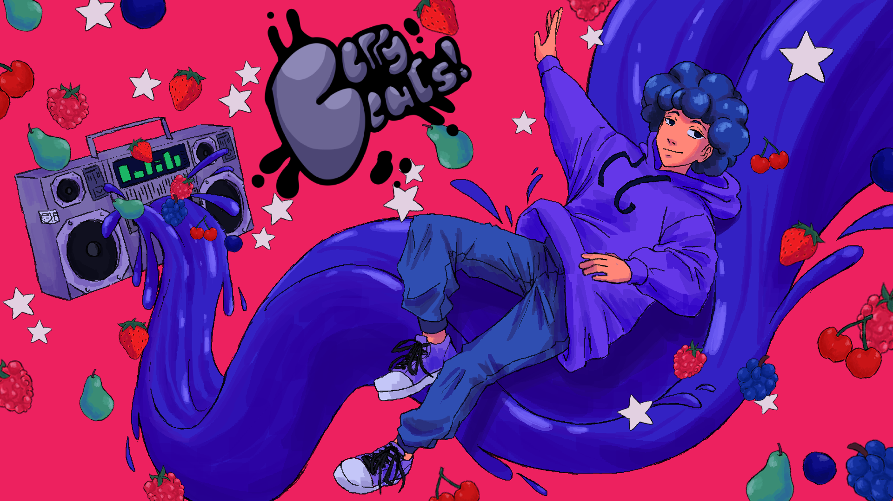
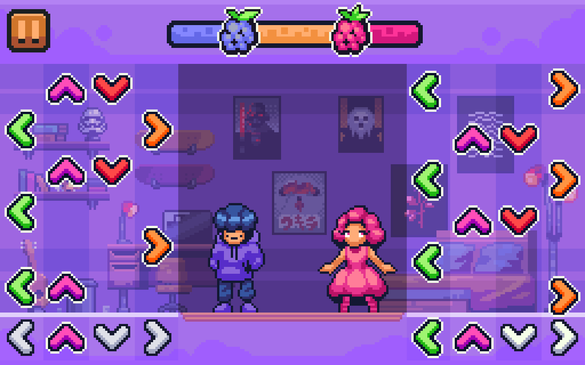
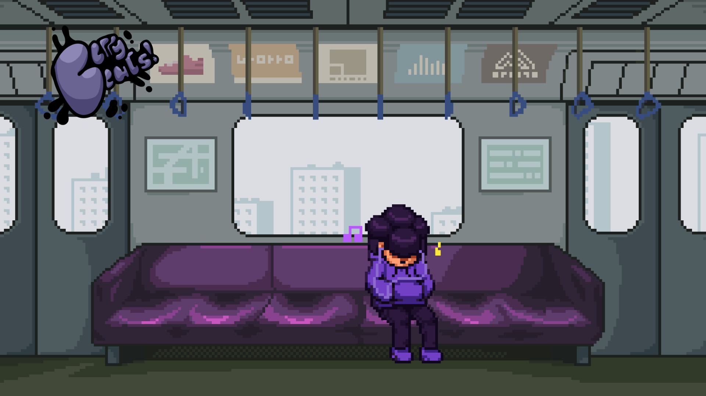

# Berry Beats



Berry Beats is a pixel art rhythm game about fruit-inspired characters in dance battles, inspired by Chainsaw Dance and Friday Night Funkin'. It includes a composer for making your own beat maps.

Play it in the browser: https://berry-beats.vercel.app

The game started as a Unity project in 2021 and was discontinued. This repository now holds a rebuild for the web (TypeScript, [Phaser 4](https://phaser.io) and [Vite](https://vite.dev)) that runs in any modern browser with no install. The original Unity project, concept art and music are kept under [`archive/`](archive).



## Play

You need [Node.js](https://nodejs.org) 20 or newer.

```bash
npm install
npm run dev
```

Open the address Vite prints (normally http://localhost:5173).

| Action | Keys |
| --- | --- |
| Hit notes (left, up, down, right) | Arrow keys or `D` `F` `J` `K` |
| Pause | `Esc` or `P` |
| Menus | Arrow keys or `WASD`, `Enter` to confirm, `Esc` to go back |

### On a phone or tablet

The game runs in mobile browsers in landscape. Hold the device sideways (a notice asks you to rotate it otherwise).

- **Playing:** the whole screen is split into four coloured columns, left, up, down and right. Tap a column to hit that arrow and keep your finger down for hold notes. Several fingers at once work.
- **Menus:** swipe or tap the yellow arrows to browse, tap an item to open it, and use the back button in the corner.
- **Fullscreen:** tap "fullscreen" in the main menu (Android and iPad). On iPhone, use Share > Add to Home Screen and launch it from there to hide the browser bars.

The site is installable as a web app from the browser menu and works offline after the first visit.

### Sync and options

Keys, volume, scroll speed, audio offset and a reduce-motion switch are under Options. **Camera** sets how much the battle camera moves: Full (zoom bumps on the beat, leaning in on whoever is dancing, punches on big moments, a shake on a miss), Light (small bar bumps only) or Off. Only the stage moves; the lanes, notes and HUD never zoom. Reduce motion turns it off. If notes feel early or late on your setup (Bluetooth headphones especially), use "measure offset" there. The results screen also tells you if you were consistently early or late and can apply the correction in one tap.

### Story mode

It is November in Berry Town. Berry, a quiet Blackberry in a purple hoodie, has hidden in his room since the summer his best friend Blueberry left for Fruit City. When the Coach hands him a ticket to the Grand Dance at the end of the Line, Raspberry drags him onto the train. The full story, cast and every line of dialogue are in [`docs/STORY_BIBLE.md`](docs/STORY_BIBLE.md).

- **The Line:** 12 stops, each opened by winning the one before. The train is the hub: pick a stop on the route map and ride. Allies who join sit on the bench with Berry.
- **A stop:** step off at the station, talk to the local who knows the way out, walk the street, look around, then face the stop's fruit in a dance battle. You must win to move on; a loss shows a line from the rival and you go again.
- **Gimmicks:** every fruit fights in its own way, from Banana's sliding notes to Dragon Fruit's flashes and Pineapple's double-cost misses.
- **Flair and your backup:** hits fill the Flair meter. When it is full, press `Space` (or tap the meter) to fire your backup's ability for 8 beats. Choose the backup on the train or in the pause menu.
- **The Grand Stage:** the last stop is a 5v5 crew battle. Order your four allies against Blueberry's crew, then Berry dances the deciding round.

| Stop | Fruit | Gimmick | Joins your crew with |
| --- | --- | --- | --- |
| 1 Berry Town | Raspberry | none | Steady: wider timing windows |
| 2 Peel Street | Banana | notes slide in from the next lane | |
| 3 Graffiti Corner | Pear | starts slow, finishes strong | Second Wind: double score in the back half of a round |
| 4 Vine Crossing | Grape | notes in pairs | |
| 5 Citrus Labs | Dr. Lemon | flawless streaks, then a meltdown that shakes your notes | Eureka: the next 8 notes score triple |
| 6 Lantern Market | Plum | long rests | |
| 7 The Club | Dragon Fruit | flashes hide your arrows | |
| 8 Rooftop | Watermelon | long holds | Rind: shrugs off your next 3 misses |
| 9 The Tunnel | Coconut | your Flair charges slower | |
| 10 Orange Plaza | Orange | rapid bursts, then rests | |
| 11 Pineapple Hall | Pineapple | misses cost double | |
| 12 Grand Stage | Blueberry | the 5v5 crew battle | |

Dialogue moves on with a click, a tap or `Enter`; `Esc` skips a scene. Options has a Reduce motion switch, which also turns Dragon Fruit's flashes into smoke, and Reset story.

### How a battle works

- **The bar** is a tug of war. Your hits push it toward your side, your misses and your rival's hits pull it back. If it empties you fail the stage (unless No Fail is on).
- **Turns:** sections of the song belong to you, to your rival or to both. A label and a spotlight show whose turn it is. Finishing one of your turns without a miss pays a Flawless bonus.
- **The stage reacts:** the camera bumps on every bar, leans in on whoever has the floor and pulls back for a face-off, and the song's drops (found from where the notes pile in) flash and punch. A miss knocks Berry back, muffles the song for a moment and has the DJ scrub the record; breaking a streak of 10 or more also gets the crowd's "aww", and now and then the MC has something to say.
- **Rounds:** the song is split into three or four rounds. Each goes to whoever was more accurate in it, and whoever takes the most rounds wins the battle. Losing the battle still clears the stage if you survive.
- **Showpieces:** combos of 10, 25, 50, 75 and 100 trigger a spin, dab, kick or freeze.

### How scoring works

Rules follow the original game: a Hit is worth 100 points, a Good 125 and a Perfect 200, multiplied by a combo multiplier that grows after 4, 6 and 16 hits in a row and resets on a miss. Hold notes count twice: once for the start and once for holding to the end. Accuracy decides the rank, from F up to BERRY+.

## Make beat maps

Choose **Beat Maps** in the main menu to create, edit, play, import and export maps. You can chart any of the built-in tracks or import your own audio file, which stays in your browser. **Soundtrack** there lists Nicole Yazmin's original six songs, each once, with a beat map for each.

Maps are stored in the browser's local storage. Use Export to save a map as a `.berrybeat.json` file and Import to load one. "Remix a story level" opens a copy of a story chart for editing.

### Auto chart

**Auto chart** in the composer (or `G`) drafts a map from the audio: it finds the tempo and first beat, detects where notes start, and places arrows on them for the difficulty you pick, with or without turns for the rival. It replaces the notes in the map as one step, so undo brings the old map back. A five minute song takes a few seconds.

Treat the result as a first draft to edit. It needs music with a steady tempo and clear attacks: live recordings that drift, free-time intros, and soft music without drums chart badly or not at all, and it says so when the tempo is unclear. In that case tap the tempo yourself (`T`), set the first beat, and run it again with "Keep". A tempo may also come out at double or half of what you would count, which only changes the bar lines.

### Composer controls

| Area | Controls |
| --- | --- |
| Mouse | Click a lane to place a note, drag up or down for a hold, drag a note to move it, drag a hold's tail to resize, right click to delete, Shift+drag to box-select, wheel to scroll, Ctrl+wheel to zoom |
| Transport | `Space` play or pause, `Enter` test play from the playhead, `W` `S` step by the snap grid, `PageUp` `PageDown` by measure, `Home` `End` |
| Lane keys | Arrows or `D` `F` `J` `K` place a note at the playhead. While the song plays they record, and holding a key makes a hold. `Tab` switches between your lanes and the rival's |
| Tools | `1` draw, `2` select, `3` erase, `Delete` removes the selection, `,` `.` nudge it, Ctrl+`A` `C` `V` |
| Settings | `[` `]` snap (1/1 to 1/8), `-` `=` zoom, `R` speed, `C` note ticks, `M` metronome, `T` tap tempo, `G` auto chart |
| File | Ctrl+`Z` `Y` undo and redo, Ctrl+`S` save, `H` help, `Esc` exit |

The editor is built for mouse and keyboard. It runs on a phone, but the labels are small.

### Beat map format

```json
{
  "format": 1,
  "id": "my-map",
  "title": "My Map",
  "artist": "Nicole Yazmin",
  "song": "level1",
  "bpm": 120,
  "offset": 0.25,
  "notes": [{ "b": 0, "l": 0 }, { "b": 1, "l": 2, "d": 2 }],
  "rival": [{ "b": 4, "l": 3 }],
  "rivalCharacter": "raspberry",
  "difficulty": 2
}
```

`b` is the beat a note lands on, `l` is the lane (0 left, 1 up, 2 down, 3 right) and `d` is the hold length in beats. `offset` is the time in seconds of beat 0 in the audio. `notes` are for the player, `rival` for the opponent. See [`src/core/chart.ts`](src/core/chart.ts).

## Develop

```bash
npm run dev        # dev server with hot reload
npm test           # unit tests (scoring, battles, chart format, composer logic, auto chart, shipped charts)
npm run test:e2e   # build, then a browser smoke test (needs Chromium: npx playwright install chromium)
npm run typecheck  # TypeScript only
npm run build      # type-check and build to dist/
npm run preview    # serve the production build
```

Project layout:

| Path | Contents |
| --- | --- |
| `src/core` | Shared code: chart format, scoring engine, battle rules, audio clock, settings, saves, UI helpers |
| `src/scenes` | One file per screen: title, menu, the train, stations and streets, lineup, play, results, ending, options, beat maps, composer |
| `src/story` | The story as data: cast, stops, dialogue (from the bible), places, progress, gimmicks, abilities, the crew battle |
| `src/explore` | Walking, doors and painted stand-in backgrounds for stations and streets |
| `src/play` | Play field rendering: notes, dancers, rival profiles, HUD, dialogue, stage effects |
| `src/composer` | Beat map editor logic and widgets |
| `public/assets` | Art, music and font used at runtime (generated, see below) |
| `public/charts` | Story beat maps: `tutorial.json` and `stop01.json` to `stop12.json` |
| `docs` | The story bible and the background art spec |
| `tools` | Scripts that generate assets and charts |
| `tests` | Unit tests and the browser smoke test |
| `archive` | The original Unity project, concept art, game art and music masters |

Handy URLs while developing: `?scene=Menu` jumps to a scene, `?scene=Play&level=stop04&autoplay=1` watches a stop's battle play itself (add `&story=1` for its dialogue), and `&at=30` starts 30 seconds in. `&miss=12` makes autoplay drop one note in 12 (or `&miss=50,62` those note ids) to show the miss reactions. Note that `story=1` with autoplay can mark a stop cleared in your save.

### Changing the story

- **Dialogue** lives in `src/story/script.ts` and must match `docs/STORY_BIBLE.md` word for word: `tests/story.test.ts` parses the bible and fails on any difference, on lines over 90 characters, unknown speakers, or expressions other than neutral and bold. Edit the bible first, then the script.
- **Station and street lines** that are not in the bible are in `src/story/places.ts`; `tests/places.test.ts` holds them to the same rules.
- **A stop** is an entry in `src/story/stops.ts` (station, fruit, role, song, stage, time of day, gimmick) plus a chart in `public/charts` and its places in `src/story/places.ts`.
- **Art** is optional at runtime: anything missing is drawn as a stand-in. To add or replace a picture, put the PNG in `public/assets/img` and list it in `src/core/assets.ts`; `tests/assets.test.ts` checks the list against the folder. Sizes and layout for stations and streets are in `docs/EXPLORE_ART.md`.

### Regenerating assets and charts

Runtime assets are built from the archived originals and committed, so this is only needed if the source art or music changes. Both scripts need Python 3 and ffmpeg.

```bash
pip install pillow fonttools numpy
python3 tools/prepare_assets.py     # backgrounds, HUD, music, font, icons, share image
python3 tools/build_characters.py   # every dancer's sprite sheet (full and lite layouts)
python3 tools/make_crowd.py         # crowd silhouettes, built from the dancers
```

Story charts are built from the music by `tools/analyze_audio.py` (needs numpy, scipy and ffmpeg). It measures each track's tempo and first beat (the stop songs are searched near the tempo they were made at), places notes on detected onsets following a section plan per chart, and validates the result. It writes the tutorial, the twelve stops and the six soundtrack charts. The composer's auto chart ([`src/composer/autochart.ts`](src/composer/autochart.ts)) is a port of the same method that runs in the browser and plans its own sections:

```bash
pip install numpy scipy
python3 tools/analyze_audio.py
```

The generated dance frames live in `archive/generated-sprites` as small, hand-editable sheets. `tools/pixelize_sprites.py` is the converter that turned the raw image-model output into those sheets, and `tools/make_stage.py` and `tools/make_judgements.py` did the same for the stage backgrounds and the judgement lettering.

## Deploy

`npm run build` produces a static site in `dist/` that can be hosted anywhere (GitHub Pages, Vercel, Netlify, itch.io). Paths are relative, so it also works from a sub-folder.

For GitHub Pages: enable Pages with "GitHub Actions" as the source under Settings > Pages, then run the "Deploy to GitHub Pages" workflow from the Actions tab.

The link preview tags in `index.html` (`og:url`, `og:image`, `twitter:image`) must be absolute URLs. They point at https://berry-beats.vercel.app, so change them if the game is hosted somewhere else.

## What changed from the Unity version

- Notes are timed from the audio clock instead of frame time, with a calibration offset.
- Beat maps are JSON measured in beats, instead of binary files tied to the Unity build.
- Hold notes are single long notes rather than runs of small ones.
- The rival is scored too, so the tug-of-war bar from the original mockups is a real contest with turns and rounds.
- Raspberry, who only existed as one concept sprite, is the rival with a full 51-frame move set. Blackberry gained 30 new frames: an idle dance loop that both characters keep up between moves, alternate moves, a hold groove, a stumble, victory and defeat poses, and showpieces (spin, dab, kick, freeze) that fire on combo milestones. These new frames were generated with an image model from the original sprites and converted to real pixel art; see `tools/build_characters.py`. In November 2026 Berry and Raspberry were redesigned (Berry with his hood half up, Raspberry in sporty streetwear) and all their frames regenerated; the first versions, including Blackberry's 21 original 2021 frames, are kept in `archive/generated-sprites/v1`. The Coach, the Pear and Dr. Lemon (51 frames), the nine other fruits (18 frames each), the portraits, the stations, streets and stages, and the judgement lettering were made the same way.
- The story grew from a handful of test levels into a 12-stop journey with dialogue, exploration, per-fruit gimmicks, crew abilities and a 5v5 finale, written up in `docs/STORY_BIBLE.md`.
- Each of the twelve stops has its own song (96 to 140 BPM, generated in November 2026) and a chart generated from it by `tools/analyze_audio.py`. Nicole Yazmin's original tracks play in the tutorial and in Beat Maps under Soundtrack, each with one chart (the charts the stops used before they had their own songs). The old test levels were timed to a placeholder song that is not part of the game.
- The menu's "Online" entry, which was never built, is replaced by Beat Maps.

## Credits

### Developers
- The contributors to this repository
- Hugo4IT (Glacier35 font, GPLv3; the web build adds capital letters and a colon to it)

### Artists
- Maxim Volk: [ArtStation](https://www.artstation.com/wlqwos/profile)
- Salvatore: [Portfolio](https://salvapixel.carrd.co/)
- Sainttufa: [Website](https://www.sainttufa.com/)

### Music
- Nicole Yazmin: [Official website](https://www.nicoleyazmin.com/). The original soundtrack: Title Screen, Main Menu, Character Select, Pause Screen, Tutorial and Level 1. Her tracks play in the tutorial and under Beat Maps > Soundtrack.

Listen to the tracks: [Berry Beats Tracks](https://drive.google.com/drive/folders/1M5X1kcofPPYjnJhVeCuum3J1FNX8nzcd?usp=sharing)

- The twelve stop songs (`public/assets/audio/berry_town.mp3` to `grand_stage.mp3`, credited in game as "Berry Beats (generated)") were generated with an AI music model (ElevenLabs Music through Higgsfield) from text prompts, in November 2026. They also play on the title, menu, map and pause screens. **Their usage rights have not been verified**: check the generator's terms for your use before shipping them commercially. They are not built from `archive/`, so `tools/prepare_assets.py` leaves them alone.

## More pictures


